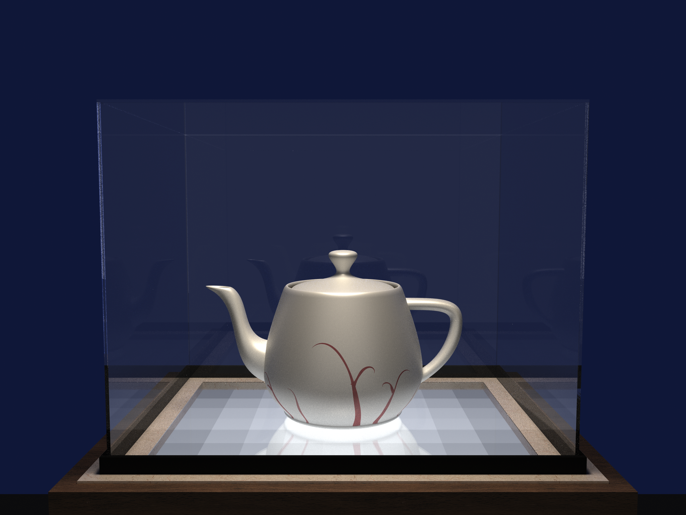

# Teapot

A RenderMan project for the Utah teapot



*Utah teapot on display in Mountain View. Path traced, [gman](https://github.com/jac18281828/gman), 2026*

## Render

Example commands:

```sh
make shot=full                            # next renders/full/full_vNNN.png
make shot=museum                          # the teapot in its museum case; builds build/tex first
make all                                  # every shot
RENDERER=gmanraytracer make shot=full     # gmanpathtracer by default
GMAN=/path/to/gman make shot=full         # gman on PATH by default
FORMAT=tiff make shot=full                # png by default; needs that driver in gman
```

Render, `tools/render.sh` writes a new frame RIB under `build/frames/` this
avoids overwriting prior versions.

## Layout

| Path | Holds |
|---|---|
| `assets/teapot/teapot.rib` | The asset's entry: every part with its look, two-sided |
| `assets/teapot/lookdev/<part>.rib` | One part's material, bound to its geometry, under a glass glaze shell |
| `assets/teapot/geo/<part>.rib` | One `PointsPolygons` of triangles with `"P"`, vertex `"N"` and `"st"` |
| `assets/teapot/teapot_tall.rib` | The teapot at the physical teapot's height, 4/3 of Blinn's |
| `assets/museum/museum.rib` | The museum display: cherry frame and plinth, marble border, glass lightbox, acrylic case and its rail |
| `assets/museum/room.rib` | The navy wall behind the case and a soft panel behind the camera for the glass to reflect |
| `assets/museum/tex/` | Master TIFFs: `<map>_diff` colour, `<map>_nrm` normal (DirectX convention) |
| `lights/studio.rib` | The light rig |
| `shots/<shot>/shot.rib` | Camera, format, samples and what the shot reads |
| `docs/museum.png` | The museum shot, a 2048 x 1536 copy of the 4096 x 3072 render at 1024 samples |
| `tools/` | `render.sh`; `glaze.py`, which writes each part's glaze shell to `build/glaze/`, `GLAZE` (0.015) out along `"N"` |
| `tests/` | `unittest` suites: `python3 -I -m unittest discover -s tests -v` |
| `AGENTS.md` | The project's facts, workflow and completion gates |


## Conventions

- Axes are RenderMan camera space: x right, y up, z away from the camera. The bottom sits at y 0
  and the lid's knob tops out at y 3.15; the spout points to +x and the handle to -x. The source is
  z-up, and the import maps a data point `(x, y, z)` to `(x, z, y)`.
- `geo/` is the master: each patch is tessellated at 32 x 32 quads per patch, each split into two
  triangles, with exact normals. `make` never generates it.
- `"N"` is the exact surface normal, unit length and finite everywhere, including the lid's
  and the bottom's collapsed edges. Every patch's normals face away from the teapot's interior.
  `"st"` is each patch's own (u, v) in [0, 1].
- A new shot is a directory under `shots/` with a `shot.rib` that has no `Display`.

## Credit

The data is from the Utah teapot, base file `teapotCGA.bpt`: the 32 bicubic Bezier patches Frank Crow
published in IEEE Computer Graphics and Applications in January 1987.

Digitized here:

- URL: `http://www.holmes3d.net/graphics/teapot/teapotCGA.bpt`
- sha256: `83c3cf09ff33cff17b8de714836c4c6758fccfc4288cef8671bacf0b7c294953`

The museum textures are CC0 scans from [ambientCG](https://ambientcg.com): `Marble020` for the
border and `Wood067` for the frame, each its 2K colour and DirectX normal map is
converted to TIFF.

## gman version

The museum shot needs gman 1.4.0 or later: polygon area lights, the ray tracer's area-light
sampling, translucent panes seen through glass, and the glass `Kr`, `Kt` and `eta` parameters. 

- The path tracer skips `ambientlight`, so `lights/studio.rib`'s ambient light adds nothing there.
- The import tessellates the patches into `PointsPolygons`; gman 1.3.1 builds nothing for `Patch`.
